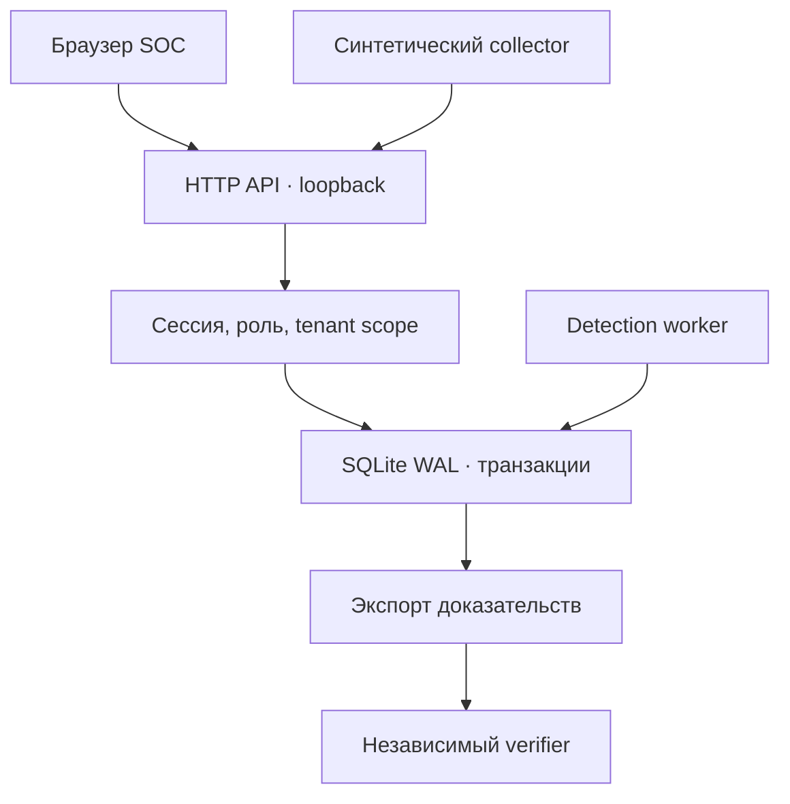

# Архитектура локального контура

Версия 0.1.0 реализует один процесс и одну SQLite-БД. Здесь проверяется согласованность предметной модели. Промышленная архитектура остаётся целью RFP; этот стенд не является её уменьшенным нагрузочным эквивалентом.

## Согласованность

Входящий batch валидируется до вставок. Затем `BEGIN IMMEDIATE` объединяет вставку событий, обновление наблюдаемого актива и аудит. ACK выдаётся после commit с `synchronous=FULL`; фактическая устойчивость зависит от файловой системы и оборудования. При исключении batch откатывается полностью. Подтверждение не означает, что детекция закончилась.

Дедупликация использует UNIQUE `(tenant, source_id, event_id)`. Совпадающее содержимое возвращает исходную sequence. Отличающееся содержимое с тем же ключом возвращает 409. Записи дедупликации не удаляются: целевое окно и retention ещё не реализованы.

Worker читает по 100 необработанных событий, фиксирует алерты, их unique effect key и отметку обработки в одной транзакции. Повторная обработка не создаёт второе логическое срабатывание. Текущий worker выполняет простые независимые предикаты, без временной корреляции, watermark и окон.

Кейс и его timeline изменяются вместе. Каждая запись получает UUID, tenant, автора, UTC-время и version. `If-Match` защищает от перезаписи конкурентного изменения. Текстовое доказательство и ссылка в timeline сохраняются атомарно.

## Доверие

Tenant и роль извлекаются из локальной серверной записи identity. Клиент не задаёт scope через тело. Все чтения предметных объектов используют tenant в SQL-предикате. Это application enforcement, не PostgreSQL RLS. Изолированность от ошибки самого SQL-слоя не доказана.

HTTP-клиенты используют случайные ключи; БД хранит только SHA-256. UI меняет ключ на короткоживущий cookie. Browser mutations требуют CSRF token. Ключ не записывается в localStorage. Cookie не имеет Secure исключительно из-за локального HTTP-профиля. Production-профиля в приложении нет.

Роли проверяются перед операцией. Проверяются tenant ownership связанных asset/case/alert и принадлежность asset выбранному case. ABAC по asset group, incident assignment, региону и классификации пока нет.

## Реагирование

Заявка хранит impact, срок действия, инициатора и список согласующих. Два разных согласующих должны отличаться от инициатора. Согласование после истечения TTL запрещается. Истечение отображается в UI; фонового перевода сохранённого статуса в EXPIRED ещё нет. Никаких dispatch и agent receipts нет. APPROVED не означает SUCCEEDED.

## Проверка доказательств

Экспорт читается из одного snapshot. Audit связывает prev_hash и канонический JSON тела. Запись acquisition содержит hash всего evidence object. Verifier проверяет цепочку, checkpoint, комплектность evidence, размеры, хеши содержимого и acquisition link. Алгоритм канонизации: сортировка ключей Python JSON, UTF-8, без пробелов и nonfinite numbers; это локальный формат, не декларация соответствия RFC 8785.

Локальный checkpoint можно передать `verify --checkpoint`. Без независимого доверия к нему экспорт является самопроверяемым, но не аутентифицированным. KMS, цифровая подпись, WORM и защищённые часы — отдельная поставка.

## Разделение при дальнейшем развитии

Следующий этап вводит PostgreSQL migrations/RLS и корпоративный OIDC. После этого ingestion, analytics и response выделяются в отдельные процессы с workload identities. Перенос UI на TypeScript/React и transport на Go/Rust не должен менять инварианты, проверенные контрактными тестами. Обратная совместимость локальных маршрутов не гарантируется до версии 1.0; целевые пути из RFP будут введены отдельно.
