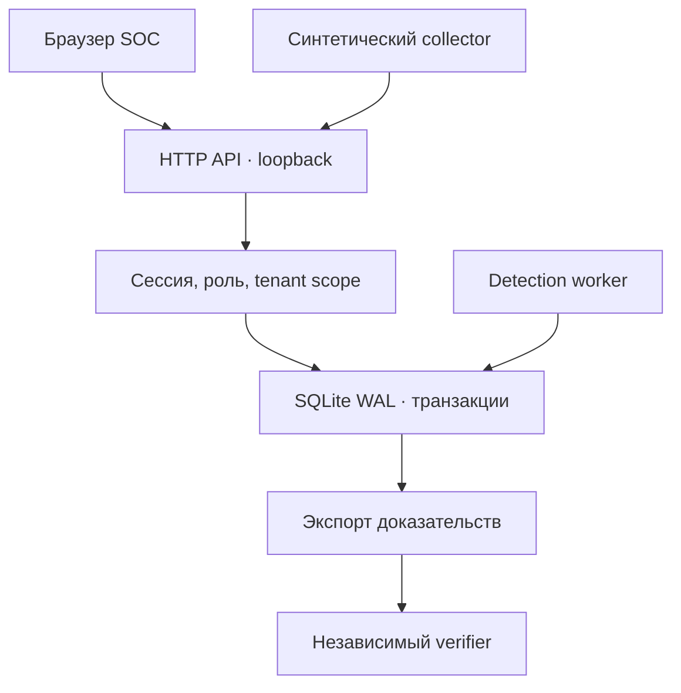

# Архитектура локального контура

Версия 0.3.0 реализует один процесс и одну SQLite-БД. Здесь проверяется согласованность предметной модели. Промышленная архитектура остаётся целью RFP; этот стенд не является её уменьшенным нагрузочным эквивалентом.

## Согласованность

Входящий batch валидируется до вставок. Затем `BEGIN IMMEDIATE` объединяет вставку событий, обновление наблюдаемого актива и аудит. ACK выдаётся после commit с `synchronous=FULL`; фактическая устойчивость зависит от файловой системы и оборудования. При исключении batch откатывается полностью. Подтверждение не означает, что детекция закончилась.

Дедупликация использует UNIQUE `(tenant, source_id, event_id)`. Совпадающее содержимое возвращает исходную sequence. Отличающееся содержимое с тем же ключом возвращает 409. Записи дедупликации не удаляются: целевое окно и retention ещё не реализованы.

Worker выбирает до 100 готовых событий с чередованием тенантов внутри выборки. Каждое событие обрабатывается в отдельной write-транзакции с повторной проверкой состояния под блокировкой. Savepoint откатывает частичные эффекты неудачной детекции. Три ошибки переводят событие в dead; промежуточные попытки отложены на 1 и 2 секунды. SQLite-ошибки распространяются вызывающему коду: они не превращают событие в poison. Unique effect key не допускает повторного алерта при retry или двух worker.

Источники связываются со stable UUID collector и явным списком активов. Проверка scope, счётчики источника, вставки событий, квоты и аудит входят в одну транзакцию приёма. Полный администратор может вводить лабораторные события только с незарегистрированным source_id; origin отмечает такой ввод. Локальные квоты не заменяют broker, mTLS или retention. Метрики состояния доступны только unrestricted admin/lead/auditor.

Текущий worker выполняет простые независимые предикаты, без временной корреляции, watermark и окон.

Кейс и его timeline изменяются вместе. Каждая запись получает UUID, tenant, автора, UTC-время и version. `If-Match` защищает от перезаписи конкурентного изменения. Текстовое доказательство и ссылка в timeline сохраняются атомарно.

## Доверие

Tenant и роль извлекаются из локальной серверной записи identity. Клиент не задаёт scope через тело. Все чтения предметных объектов используют tenant в SQL-предикате. Это application enforcement, не PostgreSQL RLS. Изолированность от ошибки самого SQL-слоя не доказана.

HTTP-клиенты используют случайные ключи; БД хранит только SHA-256. UI меняет ключ на короткоживущий cookie. Browser mutations требуют CSRF token. Ключ не записывается в localStorage. Cookie не имеет Secure исключительно из-за локального HTTP-профиля. Production-профиля в приложении нет.

Роли проверяются перед операцией. Проверяются tenant ownership связанных asset/case/alert и принадлежность asset выбранному case. В 0.2.0 реализованы ограничения по asset group, четырём уровням sensitivity и case owner. Связанные evidence и response наследуют scope кейса. Региональные ограничения и классификация фактического содержимого событий пока не реализованы. Глобальные audit/export/rules запрещены для ограниченных identities.

## Реагирование

Заявка хранит impact, срок действия, инициатора и список согласующих. Два разных согласующих должны отличаться от инициатора. Согласование после истечения TTL запрещается. Истечение отображается в UI; фонового перевода сохранённого статуса в EXPIRED ещё нет. Никаких dispatch и agent receipts нет. APPROVED не означает SUCCEEDED.

## Проверка доказательств

Экспорт читается из одного snapshot. Audit связывает prev_hash и канонический JSON тела. Запись acquisition содержит hash всего evidence object. Verifier проверяет цепочку, checkpoint, комплектность evidence, размеры, хеши содержимого и acquisition link. Алгоритм канонизации: сортировка ключей Python JSON, UTF-8, без пробелов и nonfinite numbers; это локальный формат, не декларация соответствия RFC 8785.

Локальный checkpoint можно передать `verify --checkpoint`. Без независимого доверия к нему экспорт является самопроверяемым, но не аутентифицированным. KMS, цифровая подпись, WORM и защищённые часы — отдельная поставка.

## Разделение при дальнейшем развитии

Следующий этап вводит PostgreSQL migrations/RLS и корпоративный OIDC. После этого ingestion, analytics и response выделяются в отдельные процессы с workload identities. Перенос UI на TypeScript/React и transport на Go/Rust не должен менять инварианты, проверенные контрактными тестами. Обратная совместимость локальных маршрутов не гарантируется до версии 1.0; целевые пути из RFP будут введены отдельно.

## Изменения identity в 0.2.0

Identity имеет stable UUID, revision и серверную policy. Ротация меняет token_hash, удаляет сеансы и увеличивает revision в одной транзакции. Политика не передаётся клиентом как доверенный claim: она читается из identity row. Мутации перепроверяют текущий token_hash, revision, роль, policy и живой session ID после получения write lock. Это закрывает гонку между HTTP authentication и отзывом доступа до записи.

Миграция 1 → 2 сохраняет старые ключи и присваивает им прежний unrestricted scope для совместимости. Старые cookie-сеансы удаляются. Snapshot исходной БД сохраняется до изменения схемы; при невозможности backup старт прерывается. Миграция не является промышленной системой blue/green upgrade: старые процессы должны быть остановлены.
